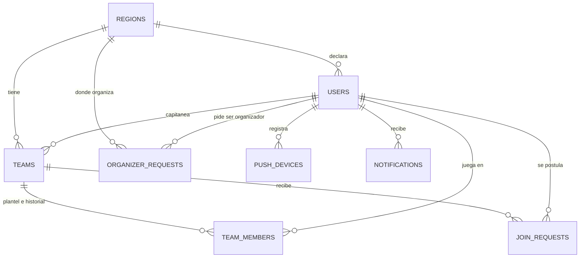
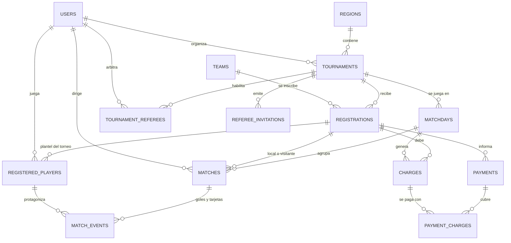
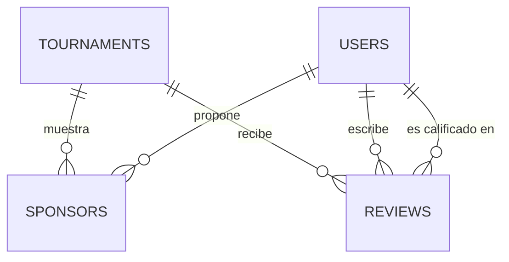

# Modelo de datos

El modelo vive en [apps/api/prisma/schema.prisma](../apps/api/prisma/schema.prisma) y se aplica con la migración `20261105120000_data_model`. Las reglas de negocio (RN) y los requerimientos (RF) son los del informe inicial.

## Convenciones

- Los nombres de modelos, tablas, columnas y valores de enums están en inglés. Los términos del informe se traducen según el glosario de abajo. Las tablas van en plural y en `snake_case`.
- Las claves son `uuid`. `users.id` es el id del usuario en Supabase Auth (`auth.users.id`). No hay clave foránea hacia `auth`, porque la base sombra de `prisma migrate dev` no tiene ese esquema. La API crea la fila al ver por primera vez un token válido (#84).
- Los montos son `numeric(12,2)` en pesos y las fechas con hora son `timestamptz`.
- Todas las tablas tienen RLS habilitado y ninguna política. La API accede con Prisma por la conexión de Postgres. Si más adelante se lee algo directo desde Supabase, se agregan políticas tabla por tabla.
- Prisma no expresa los índices únicos parciales ni los `CHECK`. Viven solo en el SQL de la migración. Al crear migraciones nuevas no hay que tocarlos.

## Glosario del informe

| Informe | Modelo | Nota |
| --- | --- | --- |
| Usuario | `User` | |
| Región | `Region` | |
| Equipo | `Team` | |
| Plantel | `TeamMember` y `RegisteredPlayer` | El primero es el plantel del equipo. El segundo es el plantel inscripto en un torneo. |
| Postulación | `JoinRequest` | |
| Torneo | `Tournament` | |
| Fecha | `Matchday` | Jornada de partidos. No es una fecha de calendario. |
| Inscripción | `Registration` | Un equipo dentro de un torneo. |
| Partido | `Match` | |
| Resultado, goleadores y tarjetas | `Match` y `MatchEvent` | El marcador va en `Match`. Cada gol o tarjeta es un `MatchEvent`. |
| Cuota y multa | `Charge` con tipo `FEE` o `FINE` | |
| Pago | `Payment` y `PaymentCharge` | Un pago puede cubrir varios cargos. |
| Baja | `removed_at` y `removal_reason` | En usuarios, torneos y sponsors. En inscripciones el estado pasa a `REMOVED`. |
| Walkover | `WALKOVER` | Estado de `Match`. |
| Vueltas | `legs` | Una o dos. |
| Árbitro | `TournamentReferee` y `RefereeInvitation` | |
| Sponsor | `Sponsor` | Nivel `MAIN` u `OFFICIAL`. |
| Review | `Review` | Tipo `TOURNAMENT`, `PLAYER` o `REFEREE`. |

## Diagramas

### Usuarios, regiones y equipos

### Torneos, partidos y pagos

### Sponsors y reviews

## Entidades

| Tabla | Qué guarda |
| --- | --- |
| `regions` | Catálogo de regiones que mantiene el admin (RF-38). |
| `users` | Perfil, rol, región, aceptación de políticas, verificación de identidad y baja. |
| `organizer_requests` | Pedido para ser organizador con descripción y fotos del lugar, y su revisión (RF-07, RF-08). |
| `teams` | Equipo con región, capitán y código para el link de invitación (RF-10, RF-13). |
| `team_members` | Plantel del equipo. `left_at` en blanco es vigente; lo demás es historial (RF-28). |
| `join_requests` | Pedido de un jugador para sumarse a un equipo (RF-11, RF-12). |
| `tournaments` | Reglas, cuota, multa, costo de arbitraje, puntos y baja (RF-15). |
| `matchdays` | Jornadas del torneo. Cada una ocupa una semana, empezando un lunes. |
| `registrations` | Un equipo dentro de un torneo, con su estado y baja (RF-14). |
| `registered_players` | Plantel de la inscripción en ese torneo. Es la referencia de goles y tarjetas. |
| `tournament_referees` | Árbitros habilitados en un torneo. |
| `referee_invitations` | Link de invitación de un solo uso para entrar como árbitro (RF-18, RF-36). |
| `matches` | Cruce, horario, árbitro, resultado, walkover y quién cargó o corrigió (RF-16, RF-17, RF-24, RF-25). |
| `match_events` | Goles, amarillas y rojas de cada jugador. De acá salen las estadísticas. |
| `charges` | Lo que debe un equipo: una cuota y una multa por fecha (RF-22). |
| `payments` | Aviso de pago con medio, comprobante y confirmación del organizador (RF-19, RF-20). |
| `payment_charges` | Qué cargos cubre cada pago. |
| `sponsors` | Marca propuesta para un torneo, su nivel, revisión y baja (RF-33, RF-34). |
| `reviews` | Calificación de un torneo, un jugador o un árbitro (RF-31, RF-39, RF-40). |
| `push_devices` | Tokens para notificaciones (RF-35). |
| `notifications` | Historial de notificaciones por usuario (RF-35). |

## Reglas de negocio y dónde se aplican

- **Base**: la restricción vive en la base y no se puede saltear.
- **API**: la valida el código al escribir, porque cruza tablas.
- **Calculada**: no se guarda, se deriva de otros datos.

| Regla | Dónde | Cómo |
| --- | --- | --- |
| RN-01 Inscripción gratis, plantel mínimo 5 o 7 verificados | API | No hay cargo de inscripción. Al generar el fixture se cuentan los `registered_players` con `identity_verified_at`. |
| RN-02 Cuota por fecha confirmada por el organizador | Base | Un cargo `FEE` por equipo y fecha, y un pago que pasa de `REPORTED` a `CONFIRMED`. |
| RN-03 Sin pago, juega, la cuota vence y suma multa | API | El cargo pasa a `OVERDUE` y se crea el cargo `FINE` de esa fecha. |
| RN-04 Con una fecha vencida pierde por walkover | API | El partido pasa a `WALKOVER` con `walkover_winner_id`. Un `CHECK` exige que el ganador sea local o visitante. |
| RN-05 Dos fechas sin pagar dan de baja | API | `registrations.status` pasa a `REMOVED`, con `removed_at` y `removal_reason`. |
| RN-06 Los partidos jugados se mantienen, los pendientes se cancelan | API | Los pendientes pasan a `CANCELLED`. Nada se borra. |
| RN-07 Saldar la deuda habilita de nuevo | Calculada | Habilitado es no tener cargos `OVERDUE`. No se guarda. |
| RN-08 La deuda de un equipo dado de baja sigue exigible | Base | Los cargos no se borran: las claves foráneas impiden eliminar la inscripción. |
| RN-09 Multa fija por fecha, configurable por torneo | Base | `tournaments.matchday_fine` y un solo cargo por inscripción, fecha y tipo. |
| RN-10 Walkover da 3-0, o ambos pierden | Base | `tournaments.walkover_goals`. Con `walkover_winner_id` vacío, ambos pierden. |
| RN-11 Puntos 3, 1 y 0 | Base | `tournaments.points_win` y `points_draw`. |
| RN-12 Desempate con fair play | Calculada | La tabla sale de `matches` y `match_events`. Amarilla 1 y roja 3 son constantes del dominio. |
| RN-13 Todos contra todos, una o dos vueltas | Base | `tournaments.legs` solo admite 1 o 2. El equipo libre es el que no tiene partido en la fecha. |
| RN-14 Una fecha por semana | Base | `matchdays.week_start` debe ser lunes. `matches.scheduled_at` guarda día y hora. |
| RN-15 Todo partido tiene árbitro y costo definido | Base y API | `tournaments.referee_fee` y `referee_fee_payer`. `matches.referee_id` puede ser nulo hasta asignarlo. |
| RN-16 Un equipo solo se inscribe en torneos de su región | API | Se compara `teams.region_id` con `tournaments.region_id` al inscribir. |
| RN-17 Organizador verificado, aprobado y que no juega | API | `organizer_requests` y `users.role`. Hay una sola solicitud pendiente por usuario. La API impide que un organizador figure en un plantel. |
| RN-18 Cualquier verificado propone sponsor | Base y API | `sponsors.proposer_id` y estado de revisión. |
| RN-19 Un solo sponsor principal por torneo | Base | Índice único parcial sobre principales aprobados y vigentes. |
| RN-20 Lectura pública, escritura con cuenta verificada | API | Las tablas no tienen políticas. La API expone los endpoints públicos de lectura. |
| RN-21 Sin identidad verificada no hay plantel ni partido | API | Se exige `identity_verified_at` al agregar a `registered_players`. |
| RN-22 Un jugador no está en dos equipos del mismo torneo | Base | Único sobre `tournament_id` y `user_id` en `registered_players`. |
| RN-23 Se suma solo si se postula y el capitán acepta | Base y API | Una postulación pendiente por jugador y equipo. Al aceptar, la API crea el miembro. |
| RN-24 Estadísticas solo desde resultados | Calculada | No hay tabla de estadísticas. Salen de `match_events` y `matches`. |
| RN-25 Una review por torneo, al terminar y solo de quien participó | Base y API | Índices únicos parciales. La API valida que el torneo esté `FINISHED` y que el autor figure en `registered_players`. |
| RN-26 El árbitro carga, el organizador corrige | API | `result_entered_by_id` y `result_corrected_by_id`. Un `CHECK` exige goles cuando el partido está `PLAYED`. |
| RN-27 El admin da de baja usuarios, torneos o sponsors | Base | `removed_at`, `removal_reason` y `removed_by_id` en las tres tablas. |

Además, claves foráneas compuestas impiden mezclar torneos: una fecha, un partido o un jugador inscripto no pueden apuntar a una inscripción de otro torneo, y un evento solo puede ser de un jugador del plantel.

## Decisiones tomadas y puntos abiertos

Estas decisiones las tomé donde el informe no define. Conviene validarlas con el equipo.

1. **Verificación de identidad.** No se guarda número de DNI ni fotos, solo `identity_verified_at`. Si el servicio que salga del spike #94 necesita una referencia, se agrega una columna. El árbitro puede quedar sin verificar.
2. **Rol y capitán.** `users.role` es nulo hasta que la persona lo elige (RF-05). El capitán no es un rol: es quien figura en `teams.captain_id`. Los roles y cómo se asigna el admin están en [roles-y-permisos.md](roles-y-permisos.md).
3. **Quién paga el arbitraje.** `referee_fee_payer` admite `ORGANIZER` o `TEAMS`. El informe no dice cómo se reparte entre equipos.
4. **Baja reversible.** RN-05 da de baja y RN-07 dice que saldar la deuda habilita de nuevo. El modelo trata la habilitación como derivada. Falta definir si un equipo dado de baja puede volver al torneo.
5. **Reviews.** El alcance del informe habla de reviews de torneos y organizadores, y los RF-31, RF-39 y RF-40 hablan de torneos, jugadores y árbitros. El modelo usa un tipo `TOURNAMENT`, `PLAYER` o `REFEREE`. El organizador se califica a través del torneo. Faltan las reglas de quién califica a quién en RF-39 y RF-40.
6. **Novedades de la región (RF-32).** No hay tabla. Se asume que el feed se arma con torneos y resultados nuevos. Si las novedades las escribe alguien, hay que agregar una.
7. **Borrar la cuenta (RF-43).** Las claves foráneas impiden borrar un usuario con historial. La propuesta es anonimizar: cambiar el nombre, quitar el avatar y marcar `removed_at`. Falta definir qué se conserva.
8. **Invitación de árbitro.** Cada link sirve para una sola persona y puede vencer o revocarse.
9. **Correcciones de resultados.** Se guarda solo la última corrección. Si el equipo quiere auditoría completa, hace falta una tabla de historial.
10. **Notificaciones.** `push_devices` y `notifications` no estaban en la lista del issue. Se agregaron por RF-35.
